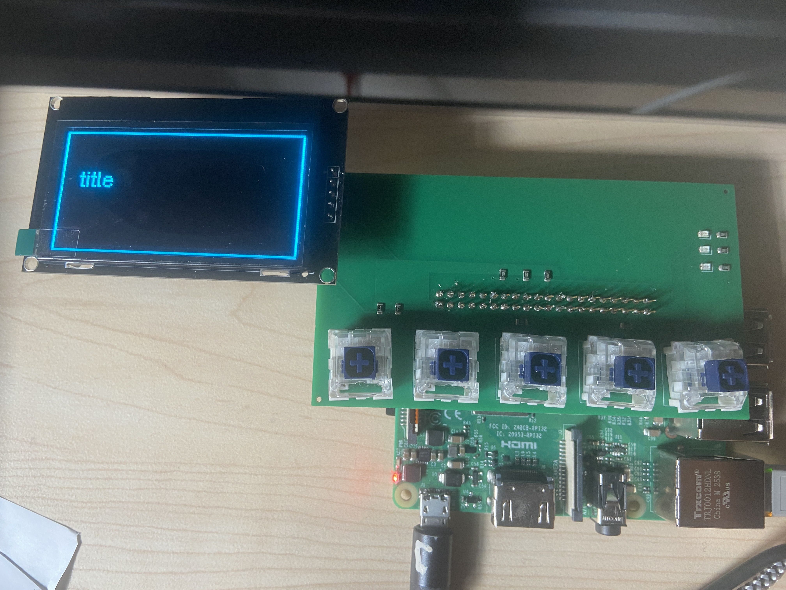

# pi-gui-lite
Have you ever wanted to use your Raspberry Pi without wiring up a hefty keyboard mouse and monitor setup or sshing into it?
PI-GUI-LITE is here to make your life easier!
Since these are the early days of this project, there is very very limited functionality right now, but expect it to grow into a much more functional tool as the days go by.

# What can it do?
Currently, the hardware hat is on version 1.0, with a few unfortunate mechanical mishaps but still operational with some hardware hacks.

## Hardware 
It comes with a 2.42 inch OLED SSD1309 display, 5 configurable MX switches and 3 general purpose LEDs. Unfortunately, many of the other pi GPIOs remain unusable, but expect that to change.

## Software 
On the software side, there is currently a main python script to run as a mini OS, allowing you to browse through and run any 'installed' or connected python scripts. 

Dependencies include luma.oled, luma.core and gpiozero, although I will take feedback on whether to switch to RPI.gpIO.
